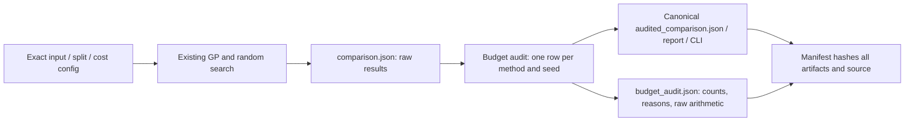

# When a declared search budget is not completed

This lab is useful for learning how to run an inspectable algorithm comparison, including a
negative outcome. Its value comes from making the experiment's selection, costs and evidence
auditable. It does not need a profitable strategy or an adoption claim to be a useful research tool.

The next concrete question was whether a declared equal budget actually produced the intended
number of admitted search entries. Candidate generation can hit its retry limit before filling
the requested population/sample. The old comparison reports those counts but still calculates
its winner rule. A valid small config with `gp.max_attempts=1` shows the problem:

| Fixed seed | Declared budget per method | GP admitted | Random admitted |
|---|---:|---:|---:|
| 20261003 | 36 | 29 | 24 |
| 20261004 | 36 | 34 | 24 |

These counts are a deterministic mechanics counterexample, not a financial experiment. The
policy and scope are in [protocol.json](evidence/budget-audit-2026-10-14/protocol.json).
Frozen candidate `d74ac2d`, original protocols and all historical results remain available unchanged.

## What the audit guarantees

`alpha_gp_lab.budget.audit_budget(report, expected_seeds, budget)` checks one GP row and one
random-search row for every predeclared seed. Counts must be integers within the declared cap;
missing, duplicate and unexpected rows fail, as do invalid qualification/test combinations.
Every search must complete the declared count before the wrapper retains the original winner
rule. Even equal counts below the cap are an incomplete protocol, rather than a retrospectively
chosen smaller budget. A seed is never silently dropped to repair the comparison.

If any count is short, `comparison` keeps the original difference and standard error but sets
`gp_beats_random` to null with an explicit budget reason. `unadjusted_comparison` retains the
original arithmetic. A full budget does not make unavailable inference available: no qualifying
pick and too few selected seeds still remain undecided.

The accounting basis is **admitted training slots, including copied GP elites**. This does not
equal unique expressions, actual expensive evaluations, total validation effort, elapsed time
or equal compute. The audit establishes this one prerequisite; it does not prove complete
algorithmic fairness, adequate statistical power or an edge.



## Run and inspect it

From the repo root, with Python 3.11 and a fresh output path:

```sh
export PYTHONPATH=src
python3.11 scripts/example_comparison.py --out runs/budget-normal
```

The default config completes the nominal budgets. To explore an actual shortfall, create a copy
of the small config, change only its retry limit, and run it independently:

```sh
python3.11 - <<'PY'
import json
from pathlib import Path
config = json.loads(Path('fixtures/comparison_small_config.json').read_text())
config['gp']['max_attempts'] = 1
path = Path('runs/budget-short-input.json')
path.parent.mkdir(exist_ok=True)
with path.open('x') as file:
    json.dump(config, file, indent=2)
PY
python3.11 scripts/example_comparison.py --config runs/budget-short-input.json --out runs/budget-short
cat runs/budget-short/budget_audit.json
cat runs/budget-short/report.md
```

The command succeeds as a recorded experiment, but its verdict is **WITHHELD**. Inspect every
seed's counts and qualification status, rather than treating a null decision as zero return.
`audited_comparison.json` is the canonical full machine-readable result named by the manifest and
CLI. Its `seeds.gp_minus_random` carries the effective verdict, while `unadjusted_gp_minus_random`
retains the old arithmetic and every numeric series/table remains available. `comparison.json`
is explicitly the raw legacy analysis; consume the manifest's `canonical_result` for decisions.
All outputs are hashed by `example_manifest.json`. A normal run can be replayed
with `python3.11 -m alpha_gp_lab verify runs/budget-normal/primary` on the same source/runtime.

The shortfall test also found that valid configs omitting the optional `baselines` field crashed
inside the analysis. The script now uses the validator's empty-baseline default. This does not
alter the existing configs that declare baselines or their historical results.

## Learning and limits

The main lesson is to distinguish requested work from completed work before interpreting an
algorithm comparison. Rejected proposals, copied elites, caching, qualification failures and
test-window reuse can each change what a headline means. The original split-perturbation checks
and drifted-book Fraction oracle remain the evidence for their respective leakage/cost claims;
this budget layer does not replace them.

The historical 34-coin/6.7-year study and losing/neutral outcome are unchanged. This work adds no
profitability or generalisation claim, no new long search, and no optimization claim. A proper
future compute-matched study would need a separate explicit protocol and measured work basis.
Local acceptance covers reporting correctness; approval to merge remains separate.

## Recorded examples and verification

The [complete-budget example](evidence/budget-audit-2026-10-14/normal-final-report.md) and
[retry-limit shortfall](evidence/budget-audit-2026-10-14/short-final-report.md) retain the numeric
output from the accepted source. [Source fingerprints and verification scope](evidence/comparison-2026-10-15.json)
distinguish the prior full local gate, including pinned real-data replay, from remote CI without
uncommitted market data. Run the recipe above to generate a fresh bundle with its own manifest.
